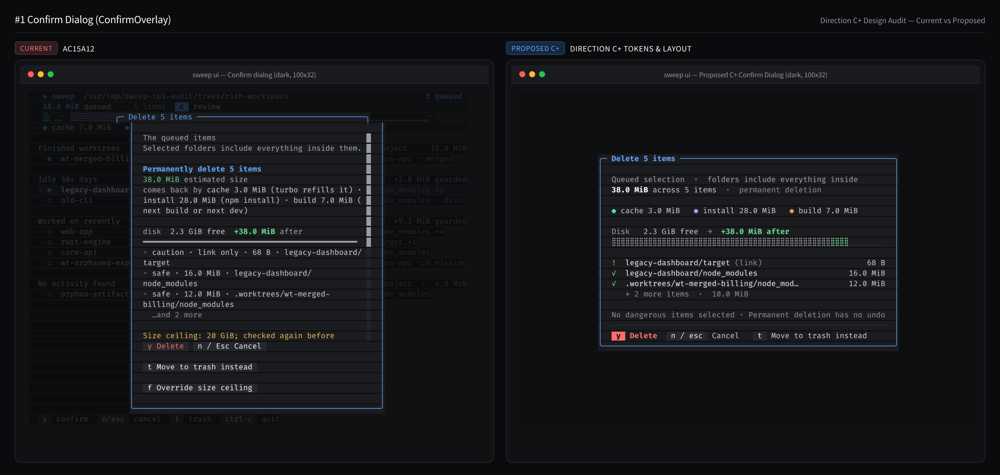
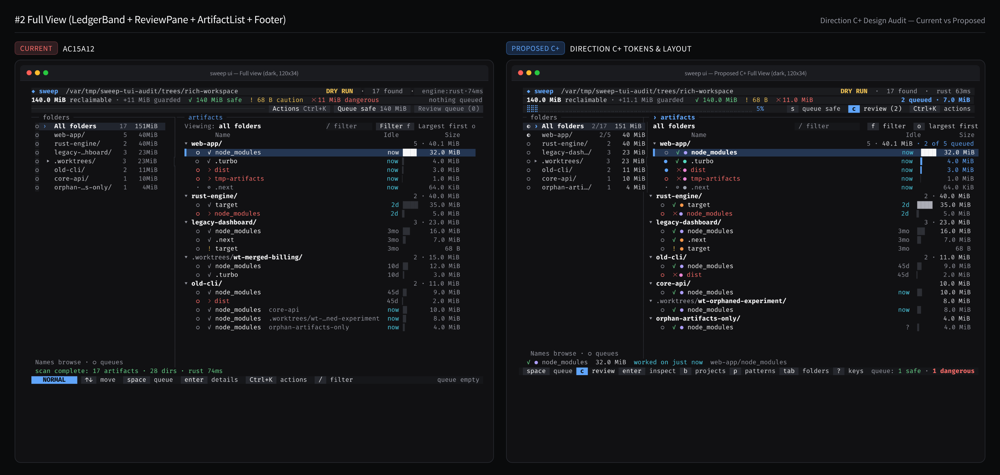
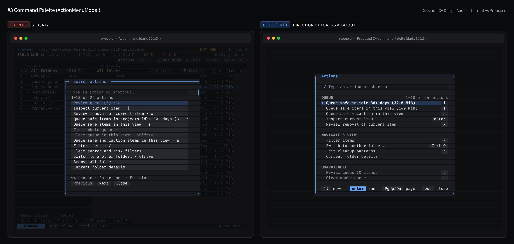
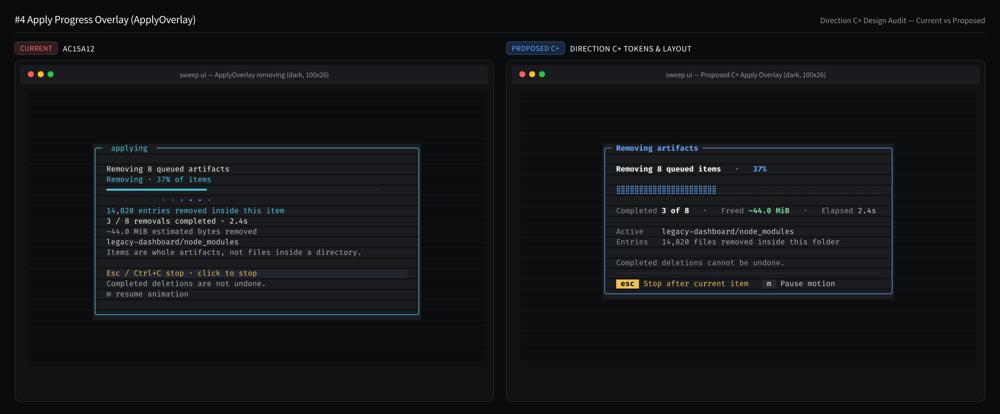
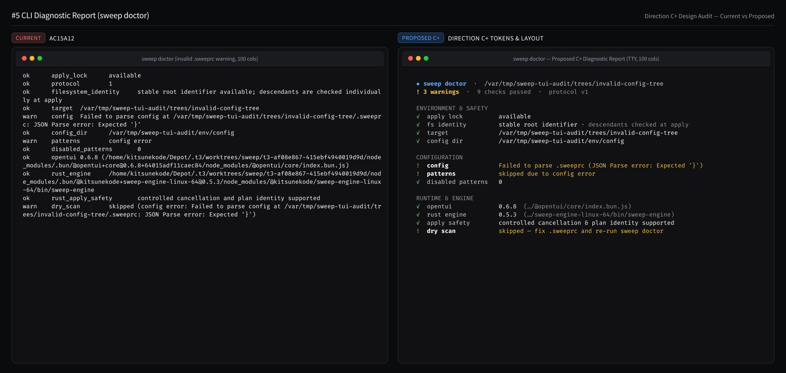

# Sweep Terminal Surface Design Audit — Direction C+

- **Audited revision:** `origin/feat/tui-cplus-redesign` (`ac15a12`, PR #167 stacked on #163 colour tokens)
- **Reference direction:** Direction C+ (owner decision D9 — Clove-inspired palette, single blue accent `#60a5fa` dark / `#1d4ed8` light, distinct OKLCH category hues, WCAG AA contrast, bold tabular headline numbers, coloured 1-cell category icons, binary IEC units `KiB`/`MiB`/`GiB`, and `.plans/kitty-graphics.md` rules)
- **Scope:** Every interactive TUI view, modal, overlay, state, edge viewport, and non-TUI CLI surface (`packages/ui`, `packages/display`, `apps/cli`)
- **Capture inventory:** 112 real PTY/CLI screenshots under `/var/tmp/sweep-tui-audit/shots/` (80 / 100 / 120 cols, dark & light, `NO_COLOR=1`, `TERM=xterm-16color`, `60×20`, `200×60`, resize mid-scan, TTY & piped) + 5 before/after mocks under `/var/tmp/sweep-tui-audit/mocks/`
- **Isolation & integrity:** Strictly read-only on product code (`git status` clean). All runs executed in an isolated `/var/tmp/sweep-tui-audit/env/` sandbox (`HOME`, `TMPDIR`, `SWEEP_CONFIG_DIR`, `XDG_CONFIG_HOME`) against generated fixture trees.

---

## Executive Summary

The **Projects View** redesign (`ProjectsView`, `StorageCard`, `ProjectDetails`, `KeyHints`, `dot-matrix`, and `theme.ts`) establishes a cohesive, high-trust visual language: a single calm `#1b1c1f` / `#f3f4f6` Storage Card, one bold tabular headline number, 4 distinct OKLCH rebuild-cost hues (`cache` teal, `install` violet, `build` amber, `custom` rose) that never collide with the `#60a5fa` blue accent, and clean rounded keycaps in the footer.

However, **every surface one step outside Projects View** still speaks earlier, pre-C+ visual dialects:

1. **The highest-stakes trust gate (`ConfirmOverlay`) overflows its own safety warning** at 100×32, stacks three raw button rows, exposes `f Override size ceiling` even at 0.01% of the limit, and uses broken grammar (`"Move to trash 5 items"`).
2. **Full View (`b`) feels like a different application**: old hairline-rule ledger, flat `ActionButton` text links, glaring Vim `NORMAL` block, `151MiB` vs `40.1 MiB` unit mismatch, missing category glyphs, and a real UX Principle §9 bug where single-artifact folders render orphan rows underneath an unrelated project (`old-cli/`).
3. **The shared `Modal` shell (`widgets.tsx`) expands every auto-height dialog to full viewport height**, turning 4-line error/info dialogs into 22-row empty caverns with stretched full-width `Esc Close` buttons.
4. **The Command Palette (`Ctrl+K`), Apply Overlay, Patterns Pane, Inspect, and Help overlays** suffer from mid-number clipping (`(3 · 3`), disabled-first default focus, glacier-cyan hue collision with `<7d` activity, stacked duplicate loaders, statusline text collisions (`r queuenem e`), and pre-C+ ASCII `[x]` checkboxes.
5. **Non-TUI CLI surfaces (`doctor`, `scan`, `status`, `inspect --plan`, `stats`, `init`, `--help`, errors)** predate Direction C+: `sweep doctor` dumps raw ragged uncoloured TSV with 140-char paths; `scan`/`status` use old ANSI yellow/cyan/green; `printError` drops indentation on multiline messages; non-TTY `scan` emits `[warn]` instead of `[caution]`.

All trust invariants remain non-negotiable across every proposal below: **reclaimable = safe + caution**, **guarded (dangerous + blocked) kept separate**, **partial `~` size markers preserved**, **every apply confirms**, **Esc unwinds one layer**, **wheel moves cursor**, and **binary IEC units (`KiB`/`MiB`/`GiB`) everywhere**.

---

## 1. Surface-by-Surface Inventory & Ratings

Rating scale: **`done`** (matches Direction C+ with no material defects) · **`inconsistent`** (functional and mostly clean, but misses C+ tokens/copy/edge states) · **`sloppy`** (visually noisy, mismatched chrome, or awkward layout/copy) · **`broken`** (real functional, clipping, trust, or contrast bug).

| #   | Surface                                                                                      | Rating                           | Representative Captures                                                                                                                            | Summary Verdict                                                                                                                                                                                                                                  |
| --- | -------------------------------------------------------------------------------------------- | -------------------------------- | -------------------------------------------------------------------------------------------------------------------------------------------------- | ------------------------------------------------------------------------------------------------------------------------------------------------------------------------------------------------------------------------------------------------ |
| 1   | **Projects View (core)**                                                                     | `done` _(edges: `inconsistent`)_ | `projects-dark-120.png`, `projects-light-100.png`, `projects-nocolor-120.png`, `projects-partial-size-100.png`                                     | Strong C+ reference. Specific edge bugs: `No activity found` showing cyan `now`, 0-match search card contradiction, 60-col risk clip, 16-color light hue collision, `core…ged` truncation.                                                       |
| 2   | **Project Details Panel**                                                                    | `done`                           | `projects-worktree-details-120.png`, `projects-expanded-120.png`                                                                                   | Clear, readable, explains rebuild cost & worktree state cleanly. Minor: idle `?` unknown state says `"worked on 3 minutes ago"` instead of unknown due to `lastActiveMs` fallback.                                                               |
| 3   | **Confirm Dialog (`ConfirmOverlay`)**                                                        | `broken`                         | `confirm-dark-100.png`, `confirm-dangerous-100.png`, `confirm-trash-100.png`, `tiny-60x20-confirm.png`                                             | Scroll-clips safety warning at 100×32, 3 stacked button rows, premature `f Override size ceiling`, `"Move to trash 5 items"`, no C+ keycaps or dot-matrix disk bar.                                                                              |
| 4   | **Full View (`b`)**                                                                          | `broken` / `sloppy`              | `full-dark-120.png`, `full-light-100.png`, `full-sidebar-focused-120.png`, `full-nocolor-100.png`                                                  | Single-artifact folders render orphan rows under `old-cli/` (§9 bug); old ledger & Vim `NORMAL` block; `151MiB` vs `40.1 MiB`; missing category glyphs; `All f…ders` empty truncation.                                                           |
| 5   | **Command Palette (`Ctrl+K`)**                                                               | `broken` / `sloppy`              | `action-menu-100.png`, `action-menu-80.png`, `action-menu-search-100.png`                                                                          | Clips label mid-number (`(3 · 3`); default-focuses disabled row #0; flat monochrome gray wall; inline `· key` instead of right-aligned keycaps; redundant footer buttons.                                                                        |
| 6   | **Apply Progress (`ApplyOverlay`)**                                                          | `sloppy`                         | `apply-in-progress-100.png`, `apply-cancel-stopping-100.png`                                                                                       | All-cyan `tokens.info` collides with `<7d` activity hue; 2 stacked loaders (`Meter` + `DotStrip`); `"Stopping 8 queued artifacts"`; raw click-strip instead of warning keycap.                                                                   |
| 7   | **Apply Receipt & Partial Failure**                                                          | `broken` / `inconsistent`        | `apply-receipt-projects-120.png`, `apply-cancel-receipt-100.png`, `apply-partial-failure-projects-120.png`, `apply-partial-failure-full-120.png`   | Receipt/notice lines hard-clip mid-number (`· 2`) and mid-word (`may already have rem`); inline error middle-truncates error name (`Permission denie…ome descendants`).                                                                          |
| 8   | **Patterns Pane (`p`)**                                                                      | `broken` / `sloppy`              | `full-patterns-pane-100.png`, `full-patterns-pane-80.png`, `full-patterns-add-100.png`                                                             | Statusline text collision (`r queuenem e`) at 100 cols & clip (`save .swe`, `.sweep`) at 80 cols; legacy ASCII `[x]`/`[ ]` checkboxes; plain toolbar buttons.                                                                                    |
| 9   | **Small Modals (`ScanError`, `UnavailableItem`, `FolderInfo`, `PatternInfo`, `ConfigSave`)** | `broken` / `sloppy`              | `scan-error-100.png`, `unavailable-item-100.png`, `folder-info-100.png`, `pattern-info-100.png`, `config-save-100.png`                             | Auto-height `Modal` stretches to full viewport (20-row empty voids); 3 competing title styles; stretched `Esc Close` button; raw un-keycapped footer text (`n / esc close`).                                                                     |
| 10  | **Inspect Overlay (`Enter` / `i`)**                                                          | `inconsistent`                   | `inspect-dark-100.png`, `inspect-light-100.png`, `inspect-blocked-100.png`                                                                         | Lowercase `" artifact "` title, duplicate `✓ .turbo .turbo`, missing category icon & `rebuildFor()` explanation, generic copy, bottom void, plain `ActionButton`s.                                                                               |
| 11  | **Help Overlays (`?`)**                                                                      | `broken` / `inconsistent`        | `help-full-120.png`, `help-projects-100.png`, `tiny-60x20-help.png`                                                                                | Full help stays single-column at 120 cols (hiding `PATTERNS`, `APP`, filter syntax); `ProjectsHelp` hard-clips mid-word at 60 cols; `>100MB` decimal typo; multi-key keycap `[y · t · esc]`.                                                     |
| 12  | **Search, Filter Picker (`f`), Folder Jump (`Ctrl+O`)**                                      | `inconsistent`                   | `search-projects-nomatch-100.png`, `filter-picker-dark-100.png`, `folder-jump-100.png`                                                             | Projects 0-match search contradicts Storage Card; `ReviewPane` placeholder says `>100MB`; `FilterPicker` duplicates footer hints; `FolderJump` clips `↺` & lists bare `.git`.                                                                    |
| 13  | **Scanning, Empty, Tiny (`60×20`), Huge (`200×60`), Resize**                                 | `broken` / `inconsistent`        | `scanning-full-live-120.png`, `empty-full-100.png`, `tiny-60x20-projects.png`, `huge-200x60-projects.png`, `scanning-resize-midscan-70x20.png`     | Live Full scan shows `"No matching artifacts."` above `SCANNING`; resize mid-scan works without crashing; `60×20` clips badges; `200×60` still crushes `core…ged`.                                                                               |
| 14  | **CLI `sweep doctor`**                                                                       | `sloppy`                         | `cli-doctor-warn-100.png`, `cli-doctor-ok-100.png`                                                                                                 | Raw ragged tab-separated dump, zero color/icons/summary, 140-char `.bun/` module paths wrap mid-word.                                                                                                                                            |
| 15  | **CLI `scan`, `clean --dry-run`, `status`, `plan`, `inspect`, `stats`, `init`**              | `inconsistent` / `sloppy`        | `cli-scan-tty-100.png`, `cli-scan-piped-100.png`, `cli-status-100.png`, `cli-inspect-plan-100.png`, `cli-stats-100.png`, `cli-init-dryrun-100.png` | Pre-C+ ANSI palette; misaligned `status` columns; `scan` headline drops `+guarded`; piped `scan` emits `[warn]` instead of `[caution]` & leaks `sweep: Scanning ...` to stdout; `idle 1h` clamp; monochrome `inspect --plan`; jittering `stats`. |
| 16  | **CLI `--help` & Error/Refusal Surfaces**                                                    | `inconsistent` / `sloppy`        | `cli-help-100.png`, `cli-help-ui-100.png`, `cli-errors-refusals-100.png`                                                                           | Unstyled 22-flag wall; British `"Colours:"` vs American `"color"`; `printError` drops multiline indent; Commander `error:` bypasses `printError`; `item(s)`/`match(es)` phrasing.                                                                |

---

## 2. Bugs vs Taste (Explicit Separation)

All **16 items below are verified real bugs** (broken layout, clipped data, misleading trust copy, hue collision, or invariant violation) confirmed both visually and against raw `.ansi` output and source code. Design-system polish & Direction C+ cohesion upgrades are tracked separately in Section 3.

| ID      | Bug                                                                                                                                                                                                                                     | Severity | Code Location                                                                                                                                                                                             | Proof Screenshot                                                             |
| ------- | --------------------------------------------------------------------------------------------------------------------------------------------------------------------------------------------------------------------------------------- | -------- | --------------------------------------------------------------------------------------------------------------------------------------------------------------------------------------------------------- | ---------------------------------------------------------------------------- |
| **B1**  | **Patterns pane statusline text collision (`r queuenem e`) at 100 cols & mid-word clip (`save .swe`, `.sweep`) at 80 cols**                                                                                                             | High     | [`app.tsx:1800`](../../packages/ui/src/app.tsx#L1800), [`presentation.ts:811-820`](../../packages/ui/src/presentation.ts#L811), [`PatternPanel.tsx:196`](../../packages/ui/src/PatternPanel.tsx#L196)     | `full-patterns-pane-100.png`, `full-patterns-pane-80.png`                    |
| **B2**  | **Auto-height `Modal` (`height={undefined}`) stretches to full viewport**, leaving 16–22 row empty caverns in `ScanError`, `PatternInfo`, `UnavailableItem`, `FolderInfo`, `ConfigSave`; column footer stretches `Esc Close` full-width | High     | [`widgets.tsx:64-99`](../../packages/ui/src/widgets.tsx#L64), [`AppModals.tsx:37,75,259,271`](../../packages/ui/src/AppModals.tsx#L37)                                                                    | `scan-error-100.png`, `pattern-info-100.png`, `unavailable-item-100.png`     |
| **B3**  | **`ConfirmOverlay` scrolls off its own safety/ceiling warning at 100×32**, exposes `f Override size ceiling` when selection is 0.01% of 20 GiB, and renders broken grammar `"Move to trash 5 items"`                                    | High     | [`ConfirmOverlay.tsx:116,131-168,235-291`](../../packages/ui/src/ConfirmOverlay.tsx#L116)                                                                                                                 | `confirm-dark-100.png`, `confirm-trash-100.png`, `confirm-dangerous-100.png` |
| **B4**  | **`No activity found` section contradicts itself**: displays glacier-cyan `now` / `3m` (`worked on 3 minutes ago`) instead of `?` / unknown, violating `.docs/ux-principles.md` §4                                                      | High     | [`projects.ts:148-158`](../../packages/ui/src/projects.ts#L148) (`lastActiveMs` falls back to artifact `modifiedMs`)                                                                                      | `projects-dark-120.png`, `projects-unknown-idle-120.png`                     |
| **B5**  | **Full View `ArtifactList` renders standalone single-artifact folders with NO group header directly under `old-cli/`**, violating `.docs/ux-principles.md` §9                                                                           | High     | [`ArtifactList.tsx:275`](../../packages/ui/src/ArtifactList.tsx#L275), [`rows.ts`](../../packages/ui/src/rows.ts)                                                                                         | `full-dark-120.png`, `huge-200x60-full.png`                                  |
| **B6**  | **Storage Card contradicts itself on 0-match search**: shows `0 B you can reclaim · 0 projects` directly above unfiltered `32.0 MiB safe in projects idle 30+ days  [i] queue idle`                                                     | Medium   | [`ProjectsView.tsx:287-293,370-427`](../../packages/ui/src/ProjectsView.tsx#L287)                                                                                                                         | `search-projects-nomatch-100.png`, `search-projects-advice-100.png`          |
| **B7**  | **`ActionMenuModal` clips command label mid-number** (`Queue safe items in projects idle 30+ days (3 · 3`) & defaults focus to disabled row #0 (`Review queue (0)`)                                                                     | Medium   | [`AppModals.tsx:243-251`](../../packages/ui/src/AppModals.tsx#L243), [`action-menu.ts`](../../packages/ui/src/action-menu.ts)                                                                             | `action-menu-100.png`, `action-menu-80.png`                                  |
| **B8**  | **`ReceiptLine` & `applyNotice` hard-clip mid-number & mid-word** (`· 2`, `may already have rem`); inline error middle-truncates error name (`✗ Permission denie…ome descendants`)                                                      | Medium   | [`ProjectsView.tsx:157-185,571`](../../packages/ui/src/ProjectsView.tsx#L157), [`presentation.ts:1005-1033`](../../packages/ui/src/presentation.ts#L1005)                                                 | `apply-cancel-receipt-100.png`, `apply-partial-failure-projects-120.png`     |
| **B9**  | **16-color light mode hue collision**: `costCache` (`#006060`) and `costInstall` (`#5522aa`) both quantize to ANSI blue (`34m`), colliding with each other and with `accent` (`◆ sweep`)                                                | Medium   | [`theme.ts:249-250`](../../packages/ui/src/theme.ts#L249), [`ansi-color-depth.ts:102-117`](../../packages/ui/src/ansi-color-depth.ts#L102)                                                                | `projects-16color-light-100.png`                                             |
| **B10** | **`ProjectsView` clips risk badges at 60 cols (`! 1 c`, `×1 d`, `×2 d`)** and over-truncates `core-api · merged` / `node_modules` to `core…ged` / `node_mo…` even at 120–200 cols                                                       | Medium   | [`ProjectsView.tsx:318-334,526-529`](../../packages/ui/src/ProjectsView.tsx#L318)                                                                                                                         | `tiny-60x20-projects.png`, `huge-200x60-projects.png`                        |
| **B11** | **Full View live scanning prints `"No matching artifacts."`** directly above the `SCANNING` chip                                                                                                                                        | Medium   | [`presentation.ts:677`](../../packages/ui/src/presentation.ts#L677)                                                                                                                                       | `scanning-full-live-120.png`, `scanning-resize-midscan-70x20.png`            |
| **B12** | **Empty Full View sidebar truncates `"All folders"` to `"All f…ders"` at 100 cols**                                                                                                                                                     | Low      | [`sidebar.ts`](../../packages/ui/src/sidebar.ts)                                                                                                                                                          | `empty-full-100.png`, `scan-error-100.png`                                   |
| **B13** | **`ProjectsHelp` hard-clips mid-word at 60×20** (`the project or ite`, `(confi`, `canc`); `HelpOverlay` & `ReviewPane` still say `>100MB` (decimal) instead of `>100MiB`                                                                | Medium   | [`HelpOverlay.tsx:94,122-192`](../../packages/ui/src/HelpOverlay.tsx#L94), [`ReviewPane.tsx:26`](../../packages/ui/src/ReviewPane.tsx#L26)                                                                | `tiny-60x20-help.png`, `help-full-120.png`                                   |
| **B14** | **`printError` drops 2-space indentation on multiline continuation lines**                                                                                                                                                              | Low      | [`packages/display/src/index.ts:606`](../../packages/display/src/index.ts#L606)                                                                                                                           | `cli-errors-refusals-100.png`                                                |
| **B15** | **Non-TTY piped `sweep scan` emits `[warn]` instead of `[caution]`** and writes `sweep: Scanning ...` progress noise to `stdout` instead of `stderr`                                                                                    | Medium   | [`packages/display/src/risk.ts`](../../packages/display/src/risk.ts), [`packages/display/src/index.ts`](../../packages/display/src/index.ts)                                                              | `cli-scan-piped-100.png`                                                     |
| **B16** | **Copy & unit drift across CLI/TUI**: `sweep status` clamps 1-minute projects to `idle 1h`; `cli.ts:246` uses British `"Colours:"` next to American `"color"`; `init.ts`/`index.ts` print `1 match(es) are`, `item(s)`, `session(s)`    | Low      | [`apps/cli/src/cli.ts:246`](../../apps/cli/src/cli.ts#L246), [`packages/display/src/init.ts`](../../packages/display/src/init.ts), [`packages/display/src/index.ts`](../../packages/display/src/index.ts) | `cli-status-100.png`, `cli-help-100.png`, `cli-errors-refusals-100.png`      |

> **Verified non-bugs (do not file):** Raw `.ansi` width checks (`len=116` at 120 cols, `len=57` at 60 cols) confirmed that Sweep's Braille `dot-matrix` bar and scrollbar column emit exact terminal cell widths. Any apparent narrowing of Braille characters in browser-rendered screenshots is a Chromium font-fallback metric for `U+2800–U+28FF`, not an OpenTUI layout bug.

---

## 3. Ranked Improvements (Most Visible & Most-Used First)

### #1 — Confirm Dialog (`ConfirmOverlay`) · `broken` / `sloppy` · Effort: **M**

- **Surface:** [`packages/ui/src/ConfirmOverlay.tsx`](../../packages/ui/src/ConfirmOverlay.tsx)
- **Current captures:** `confirm-dark-100.png`, `confirm-light-100.png`, `confirm-dangerous-100.png`, `confirm-trash-100.png`, `confirm-dryrun-100.png`, `confirm-single-with-queue-100.png`, `tiny-60x20-confirm.png`
- **Proposed mock:** [`top1-confirm-compare.png`](./top1-confirm-compare.png) (`top1-confirm-proposed.png`)
- **What's wrong:**
  - **Bug (B3):** At `100×32`, the body overflows into a `<scrollbox>`, hiding the size-ceiling / irreversible-deletion safety text (`"Size ceiling: 20 GiB; checked again before..."` clipped right above the footer).
  - **Bug (B3):** `f Override size ceiling` is rendered unconditionally even when deleting `38.0 MiB` out of a `20 GiB` ceiling (0.18%), adding noisy clutter and inviting accidental bypasses.
  - **Bug (B3):** Trash mode renders ungrammatical `"Move to trash 5 items"`.
  - **Visual/hierarchy drift:** Three stacked `ActionButton` rows eat 5 vertical rows (`y Delete` + `n / Esc Cancel`, then `t Move to trash instead`, then `f Override size ceiling`). Rebuild-cost summary wraps awkwardly mid-sentence (`comes back by cache 3.0 MiB (turbo refills it) · install 28.0 MiB...`). Disk-after meter is a flat solid rule instead of C+ dot-matrix (`⣿`/`⣀`). Sample items lead with `· safe · 16.0 MiB ·` prose instead of scannable risk glyph + path + right-aligned tabular size.
- **Proposed Direction C+ design:**
  - **Container:** Auto-sized `Modal` card (`width: clamp(54, cols - 10, 66)`, `height: undefined` after fixing B2), `background: tokens.surface`, `borderColor: hasDangerous ? tokens.danger : tokens.borderFocus` (amber `tokens.warning` in dry-run). Title: `"Delete 5 items"` / `"Move 5 items to trash"` / `"Dry run — 5 items"`.
  - **Header block (2 lines):**
    - Line 1 (`tokens.textMuted`): `"Queued selection · folders include everything inside"` (or `"Single item · 5 queued items stay queued"` when confirming a single item via `x`).
    - Line 2: **Bold tabular headline** `38.0 MiB` (`tokens.text`, bold — single bold headline per card) + `" across 5 items"` (`tokens.textSecondary`) + `"  ·  permanent deletion"` / `"  ·  move to trash"` / `"  ·  dry run"` (`tokens.textDim`). Preserve `~` prefix whenever any selected size is partial.
  - **Rebuild-cost legend (1 line):** Reuse Projects View's exact 1-cell category dots & hues: `● cache 3.0 MiB   ● install 28.0 MiB   ● build 7.0 MiB` (`costCache`, `costInstall`, `costBuild`, `costCustom`; letter prefixes `C`/`I`/`B`/`X` in `NO_COLOR`).
  - **Disk-after strip (2 lines):** `Disk   2.3 GiB free  →  +38.0 MiB after` (`+38.0 MiB after` in `tokens.positive`, bold), followed by a 1-row Braille dot-matrix bar (`tokens.textDim` used, `tokens.positive` reclaimed slice, `tokens.meterTrack` free).
  - **Sample list (max 3 rows + overflow tally):** Left-aligned risk icon (`✓` `positive`, `!` `warning`, `✗` `danger`) + truncated relative path (`tokens.text`) + optional `(link)` tag (`tokens.textDim`) + right-aligned tabular size (`tokens.textSecondary`). When dangerous items exist, sort dangerous items first and add an explicit 1-line red warning callout (`tokens.danger`) above the footer.
  - **Conditional ceiling guard:** Only show `"Exceeds 20 GiB ceiling"` + `[f] override ceiling` when `selectedBytes > maxSizeBytes`. Otherwise omit completely.
  - **Single-row C+ keycap footer (below `tokens.border` hairline):**
    - `[y]` (`danger` fill + `accentContrast` bold; `accent` fill in trash/dry-run) `Delete` · `[n / esc]` (`controlBg`) `Cancel` · `[t]` (`controlBg`) `Move to trash instead` (or `Delete permanently`).
    - At `< 72 cols`: wrap footer cleanly onto 2 compact keycap rows without clipping.
  - **Dangerous double-confirm preserved:** Keep the typed/explicit dangerous confirmation gate intact whenever `dangerousCount > 0`.

---

### #2 — Full View (`b`: LedgerBand, ReviewPane, ArtifactList, ScopeSidebar, Footer) · `broken` / `sloppy` · Effort: **L**

- **Surface:** [`LedgerBand.tsx`](../../packages/ui/src/LedgerBand.tsx), [`ReviewPane.tsx`](../../packages/ui/src/ReviewPane.tsx), [`ArtifactList.tsx`](../../packages/ui/src/ArtifactList.tsx), [`ScopeSidebar.tsx`](../../packages/ui/src/ScopeSidebar.tsx), [`rows.ts`](../../packages/ui/src/rows.ts), [`sidebar.ts`](../../packages/ui/src/sidebar.ts), [`presentation.ts`](../../packages/ui/src/presentation.ts)
- **Current captures:** `full-dark-120.png`, `full-dark-80.png`, `full-light-120.png`, `full-sidebar-focused-120.png`, `full-visual-range-100.png`, `full-nocolor-100.png`, `full-16color-100.png`, `empty-full-100.png`, `scanning-full-live-120.png`
- **Proposed mock:** [`top2-full-view-compare.png`](./top2-full-view-compare.png) (`top2-full-view-proposed.png`)
- **What's wrong:**
  - **Bug (B5 — UX Principle §9):** Single-artifact folders (`core-api`, `.worktrees/wt-orphaned-experiment`, `orphan-artifacts-only`) omit their group header and float directly underneath `old-cli/` — visually looking like children of `old-cli/`.
  - **Bug (B11):** During live scanning, Full View renders `"No matching artifacts."` right above the `SCANNING` indicator.
  - **Bug (B12):** Empty Full View truncates `"All folders"` to `"All f…ders"` in the sidebar at 100 cols.
  - **Bug (B13):** Filter input placeholder uses decimal `>100MB` instead of binary `>100MiB`.
  - **Visual break from Projects View:**
    - Top band uses flat `bg` + horizontal hairline + unstyled right-aligned text buttons (`Actions Ctrl+K  Queue safe 140 MiB  Review queue (0)`) instead of a compact 3-row Direction C+ `StorageCard` (`surface` fill + dot-matrix queue progress bar + C+ keycaps).
    - Sidebar formats sizes without spaces (`151MiB`, `40MiB`) right beside `40.1 MiB` in the artifact list.
    - Artifact rows lack the 1-cell colored rebuild-cost dot (`●` `costCache`/`costInstall`/`costBuild`/`costCustom`) that Projects View teaches users to read.
    - Bottom statusline uses a glaring solid-blue Vim `NORMAL` block (`#60a5fa` bg) that steals focus from the active row and makes `sweep` feel like a modal editor instead of a cleanup tool.
    - Active pane focus is barely distinguishable (`folders` vs `artifacts` header only changes subtle fg tint; needs `› artifacts` accent indicator + calm `selectionSoftBg` on inactive sidebar highlight).
- **Proposed Direction C+ design:**
  - **Compact C+ Ledger Card (3 rows, `tokens.surface`, 1-col outer gutter):**
    - Row 1: `◆ sweep` (`accent`, bold) + path (`textSecondary`) | right: `DRY RUN` (`warning`, bold) · `17 found · rust 63ms` (`textMuted`).
    - Row 2: **`140.0 MiB`** (`text`, bold) `reclaimable` + `· +11.1 MiB guarded` (`textDim`) + risk breakdown (`✓ 140.0 MiB` `positive`, `! 68 B` `warning`, `✗ 11.0 MiB` `danger`) | right: `2 queued · 7.0 MiB` (`accent`, bold; or `nothing queued` `textDim`).
    - Row 3: Inline Braille dot-matrix queue meter (`accent` filled / `meterTrack` track + `%`) | right: C+ keycap actions `[s] queue safe` · `[c]` (accent-filled when queue > 0) `review (2)` · `[Ctrl+K] actions`.
  - **Always emit explicit group headers (`▾ core-api/`, `▾ .worktrees/wt-orphaned-experiment/`, `▾ orphan-artifacts-only/`)** even for 1-artifact folders (fixes B5 / UX Principle §9).
  - **Artifact rows:** `[▌] [○/●/·] [✓/!/✗/⊘] [● cost-hue] name  ...  idle  bar  size`. Every number tabular-aligned, every size formatted with space (`151 MiB`, `40.1 MiB`). Unknown idle renders `?` (`textDim`), never `now`.
  - **Calm C+ keycap footer (`tokens.statusBg`):** Remove the solid blue `NORMAL` badge (only show a compact `VISUAL` pill in `tokens.accent` during active `v` range selection!). Show C+ keycaps on the left (`[space] queue  [c] review  [enter] inspect  [b] projects  [p] patterns  [tab] folders  [?] keys`) and live queue risk summary on the right (`queue: 1 safe · 1 dangerous`).
  - **Narrow (`80 cols`):** Auto-collapse `ScopeSidebar` (or toggle via `tab`), drop inline size bar, keep risk + cost dot + name + size intact.

---

### #3 — Command Palette (`ActionMenuModal`, `Ctrl+K`) · `broken` / `sloppy` · Effort: **M**

- **Surface:** [`packages/ui/src/AppModals.tsx:218-262`](../../packages/ui/src/AppModals.tsx#L218), [`packages/ui/src/action-menu.ts`](../../packages/ui/src/action-menu.ts)
- **Current captures:** `action-menu-100.png`, `action-menu-80.png`, `action-menu-search-100.png`, `action-menu-nomatch-100.png`
- **Proposed mock:** [`top3-action-menu-compare.png`](./top3-action-menu-compare.png) (`top3-action-menu-proposed.png`)
- **What's wrong:**
  - **Bug (B7):** Long labels clip right through their own numeric tally: `Queue safe items in projects idle 30+ days (3 · 3`.
  - **Bug (B7):** Opens with row #0 focused on a **disabled** item (`Review queue (0) · c`), so pressing `Enter` immediately does nothing.
  - **Sloppy presentation:** Flat monochrome gray list with zero category grouping; shortcuts appended inline as plain `· c`, `· i`, `· Ctrl+O` text; redundant 2-line footer (`↑↓ choose · Enter open · Esc close` stacked over `Previous  Next  Close` plain buttons).
- **Proposed Direction C+ design:**
  - **Modal title:** `"Actions"` (`borderColor: tokens.borderFocus`, width `clamp(50, cols - 12, 62)`).
  - **Inset search field (`tokens.surfaceInset`):** `/ Type an action or shortcut…` with `accent` prompt glyph.
  - **Grouped sections (`textDim`, uppercase micro-headers) with disabled actions sunk to `UNAVAILABLE` at the bottom:**
    - `QUEUE` (with right-aligned `1–10 of 24 actions` counter)
    - `NAVIGATE & VIEW`
    - `UNAVAILABLE` (dimmed `textDim`, never focused by default when an enabled action exists)
  - **Right-aligned C+ keycaps per row:** Label truncated cleanly on the left with full byte count preserved (`Queue safe in idle 30+ days (32.0 MiB)`), shortcut rendered as a crisp right-aligned keycap (`[i]`, `[s]`, `[enter]`, `[Ctrl+O]`) on `controlBg` (or `selectionSoftBg` on the active `selectionBg` row). Active row leads with `› ` (`tokens.accent`, bold).
  - **Single-row C+ keycap footer:** `[↑↓] move   [enter] run   [PgUp/Dn] page   [esc] close` — remove the duplicate `Previous  Next  Close` button strip.

---

### #4 — Apply Progress Overlay (`ApplyOverlay`) · `sloppy` · Effort: **S–M**

- **Surface:** [`packages/ui/src/ApplyOverlay.tsx`](../../packages/ui/src/ApplyOverlay.tsx)
- **Current captures:** `apply-in-progress-100.png`, `apply-cancel-stopping-100.png`
- **Proposed mock:** [`top4-apply-overlay-compare.png`](./top4-apply-overlay-compare.png) (`top4-apply-overlay-proposed.png`)
- **What's wrong:**
  - **Hue collision:** Border, title, progress bar, dot strip, and entry counter all use glacier-cyan `tokens.info` (`#4ecee5`), which Direction C+ reserves specifically for `<7d` recent activity.
  - **Duplicate stacked loaders:** Renders both a horizontal `Meter` bar AND a separate animated `DotStrip` row directly beneath it.
  - **Awkward copy:** Lowercase `" applying "` border title; stopping state says `"Stopping 8 queued artifacts"` (ambiguous — sounds like it's stopping 8 already-running items rather than finishing the active item); `"Items are whole artifacts, not files inside a directory."` adds clutter mid-operation; `"m resume animation"` / `"pause animation"` sits detached at the bottom.
  - **Old chrome:** `"Esc / Ctrl+C stop · click to stop"` sits on a flat tinted bar instead of a proper C+ keycap footer.
- **Proposed Direction C+ design:**
  - **Card:** `title: "Removing artifacts"` (or `"Stopping removal"` with `tokens.warning` border once cancel is requested; `tokens.borderFocus` during active apply). Width `clamp(52, cols - 12, 64)`.
  - **Single progress visual:** Headline `Removing 8 queued items   ·   37%` (`text` bold + `accent` bold), followed by **one** full-width Braille dot-matrix progress bar (`accent` filled `⣿`, `meterTrack` remaining `⣀` — or `warning` while stopping). Respects `m` pause motion cleanly (static bar, no pulsing).
  - **Structured 1-line tabular telemetry strip:** `Completed 3 of 8   ·   Freed ~44.0 MiB   ·   Elapsed 2.4s` (`Freed` in `tokens.positive` bold, preserving `~` estimated marker).
  - **Aligned key/value current-target block:**
    - `Active    legacy-dashboard/node_modules`
    - `Entries   14,820 files removed inside this folder`
  - **Trust reminder (`textDim`):** `Completed deletions cannot be undone.` (or `Waiting for current item to finish… completed deletions stay removed.` while stopping).
  - **C+ keycap footer:** `[esc]` (`warning` fill, bold `accentContrast`) `Stop after current item` `[m]` (`controlBg`) `Pause motion` (keeping `Ctrl+C` wired as an immediate alias).

---

### #5 — CLI Diagnostic & Utility Surfaces (`sweep doctor`, `inspect --plan`, `stats`, `init`) · `sloppy` · Effort: **M**

- **Surface:** [`apps/cli/src/handlers/doctor.ts`](../../apps/cli/src/handlers/doctor.ts), [`packages/display/src/index.ts`](../../packages/display/src/index.ts), [`packages/display/src/init.ts`](../../packages/display/src/init.ts)
- **Current captures:** `cli-doctor-warn-100.png`, `cli-doctor-ok-100.png`, `cli-inspect-plan-100.png`, `cli-stats-100.png`, `cli-init-dryrun-100.png`
- **Proposed mock:** [`top5-cli-doctor-compare.png`](./top5-cli-doctor-compare.png) (`top5-cli-doctor-proposed.png`)
- **What's wrong:**
  - **`sweep doctor`:** Raw uncolored 3-column text dump (`status  name  detail`) with zero header, zero pass/warn summary, zero color hierarchy, and 140-char `.bun/` node_modules paths that wrap awkwardly mid-word (`…/packages/ui/no` / `de_modules/…`).
  - **`sweep inspect --plan`:** Completely monochrome key-value list with raw ISO timestamps, ungrouped metadata, and unaligned `risk:`/`size:`/`path:` columns.
  - **`sweep stats`:** Column widths jitter from line to line (`24 KiB` vs `140.0 MiB` unpadded) and uses `session(s)` / `item(s)` robotic pluralization.
  - **`sweep init --dry-run`:** Dumps an unindented JSON blob flush against column 0 and prints `"1 match(es) are"`.
- **Proposed Direction C+ design (TTY mode; `--json` and non-TTY keep clean machine/plain output):**
  - **`sweep doctor`:**
    - Header: `◆ sweep doctor` (`accent`, bold) `·` `<target path>` (`textSecondary`) + 1-line summary: `! 3 warnings  ·  9 checks passed  ·  protocol v1` (or `✓ All 12 checks passed  ·  protocol v1` in `positive`).
    - Group checks under 3 calm micro-headers (`ENVIRONMENT & SAFETY`, `CONFIGURATION`, `RUNTIME & ENGINE`) with 1-cell status glyph (`✓` `positive`, `!` `warning`, `✗` `danger`), fixed 20-col label column, primary value, and middle-truncated dimmed module paths (`…/@opentui/core/index.bun.js`). Warnings pop in bold label + `warning` detail text.
  - **`sweep inspect --plan`:** Apply C+ header (`◆ sweep inspect · <plan id>`), risk badge (`✓ safe` / `! caution` / `✗ dangerous`), tabular sizes, human relative timestamp + dimmed ISO, and rebuild-cost dot.
  - **`sweep stats`:** Right-aligned tabular numeric column, clean singular/plural helper (`1 session`, `3 items`), C+ `positive` freed total.
  - **`sweep init --dry-run`:** 2-space indented bordered/inset JSON preview, real pluralization (`1 match is` / `3 matches are`).

---

### #6 — Shared `Modal` Shell & Small Modals (`ScanError`, `UnavailableItem`, `FolderInfo`, `PatternInfo`, `ConfigSave`) · `broken` / `sloppy` · Effort: **M**

- **Surface:** [`packages/ui/src/widgets.tsx:64-99`](../../packages/ui/src/widgets.tsx#L64), [`packages/ui/src/AppModals.tsx`](../../packages/ui/src/AppModals.tsx)
- **Current captures:** `scan-error-100.png`, `unavailable-item-100.png`, `folder-info-100.png`, `pattern-info-100.png`, `config-save-100.png`
- **What's wrong:**
  - **Bug (B2):** `Modal` sets `flexGrow` / unbounded height when `height` is omitted, stretching 4-line dialogs (`ScanErrorModal`, `PatternInfoModal`, `UnavailableItemModal`, `FolderInfoModal`) into full-screen 28-row empty boxes.
  - **Bug (B2):** Single-button footers in column flex stretch `Esc Close` across the entire modal width (`unavailable-item-100.png`, `pattern-info-100.png`).
  - **3 competing title conventions:** Lowercase padded `" scan error "`, `" applying "`, `" artifact "` vs Sentence-case `"Search actions"`, `"Delete 5 items"`, `"Save pattern changes?"`.
  - **Un-keycapped footer text:** `ConfigSaveModal` prints raw `y save and exit  ·  d discard  ·  n / esc stay`; `ScanErrorModal` prints raw `r retry scan  ·  q quit`.
- **Proposed Direction C+ design:**
  - Fix `Modal` (`widgets.tsx`) to content-fit vertically (`maxHeight: rows - 4`, `flexShrink: 1`, no forced `height: "100%"` on auto-height cards), centered vertically & horizontally over a dimmed backdrop.
  - Standardize **every** modal title to clean Sentence case with 1-space padding (`Scan failed`, `Item unavailable`, `Folder details`, `Pattern details`, `Save pattern changes?`, `Actions`, `Delete 5 items`, `Removing artifacts`, `Artifact details`, `Keyboard shortcuts`).
  - Add a shared `<ModalFooter>` using Direction C+ `Keycap` tokens (horizontal row, never stretched full-width, separated by a 1-row `tokens.border` hairline).
  - Semantic border colors only: `tokens.borderFocus` (default/info), `tokens.warning` (caution / dry-run / stopping), `tokens.danger` (scan error / dangerous confirm).

---

### #7 — Patterns Pane (`p`) & Statusline · `broken` / `sloppy` · Effort: **S–M**

- **Surface:** [`packages/ui/src/PatternPanel.tsx`](../../packages/ui/src/PatternPanel.tsx), [`packages/ui/src/app.tsx:1800`](../../packages/ui/src/app.tsx#L1800), [`packages/ui/src/presentation.ts:811-820`](../../packages/ui/src/presentation.ts#L811)
- **Current captures:** `full-patterns-pane-100.png`, `full-patterns-pane-80.png`, `full-patterns-add-100.png`
- **What's wrong:**
  - **Bug (B1):** At 100 cols, the statusline's left hints and right queue hint overwrite each other into garbled `r queuenem e`. At 80 cols, toolbar and hint lines clip mid-word (`save .swe`, `.sweep`).
  - **Legacy glyphs & controls:** Uses ASCII `[x]` / `[ ]` checkboxes instead of Direction C+ `●` (`tokens.accent`) / `○` (`tokens.textDim`). Toolbar actions (`Add a  Toggle space  Save w  Reset r`) are plain un-keycapped text.
  - Missing rebuild-cost hue dot on each pattern row (`●` `costCache`/`costInstall`/`costBuild`/`costCustom`) so users immediately see how each pattern maps to Projects View categories.
- **Proposed Direction C+ design:**
  - Fix statusline truncation with strict priority-tiered keycap fitting (matching `KeyHints.tsx` in Projects View) so left and right slots never overlap at 80 or 100 cols.
  - Replace `[x]`/`[ ]` with `●`/`○` (`[x]`/`[ ]` kept only in `NO_COLOR` fallback if desired, or `●`/`○` everywhere for consistency with artifact queue circles) + 1-cell colored rebuild-cost dot.
  - Convert toolbar to C+ keycaps (`[a] add  [space] toggle  [w] save  [r] reset`) that drop secondary labels cleanly at 80 cols.
  - Make `"Add pattern"` input inset (`tokens.surfaceInset`) with clear inline validation feedback and `[enter] add  [esc] cancel` keycaps.

---

### #8 — Inspect Overlay (`Enter` / `i`) · `inconsistent` · Effort: **S**

- **Surface:** [`packages/ui/src/InspectOverlay.tsx`](../../packages/ui/src/InspectOverlay.tsx)
- **Current captures:** `inspect-dark-100.png`, `inspect-dark-120.png`, `inspect-dark-80.png`, `inspect-light-100.png`, `inspect-blocked-100.png`
- **What's wrong:**
  - Lowercase `" artifact "` border title; header duplicates the name (`✓ .turbo .turbo`).
  - Missing the rebuild-cost category dot & human `rebuildFor()` explanation already implemented for `ProjectDetails` (so `.turbo` and `.next` fall back to generic `"Generated output"` instead of `"turbo refills it"` / `"next build or next dev"`).
  - Stretches vertically leaving a 6–8 row empty void at the bottom (`Modal` height issue); actions use old `ActionButton` text links instead of C+ keycaps.
- **Proposed Direction C+ design:**
  - Title: `"Artifact details"` (auto-height C+ `Modal`).
  - Header: Risk icon + category dot + single bold name + right-aligned bold tabular size (`✓ ● .turbo` … **`4.0 MiB`**; `~` preserved if partial).
  - Reuse `rebuildFor()` / `costBucket()` from `ProjectDetails` so Projects View and Full View give identical, trustworthy explanations (`Rebuilds via   turbo refills it`, `Risk           safe · matched by .turbo`).
  - Blocked items (`⊘`): highlight blocking reason (e.g., `"Tracked in git — cannot be queued"`) on a calm `tokens.surfaceInset` strip and disable/omit `space` queue keycap cleanly.
  - Footer: `[space] queue` (or `unqueue`) · `[x] remove now` · `[esc] close`.

---

### #9 — Help Overlays (`HelpOverlay` & `ProjectsHelp`, `?`) · `broken` / `inconsistent` · Effort: **S**

- **Surface:** [`packages/ui/src/HelpOverlay.tsx`](../../packages/ui/src/HelpOverlay.tsx)
- **Current captures:** `help-full-120.png`, `help-full-100.png`, `help-full-80.png`, `help-projects-120.png`, `help-projects-80.png`, `tiny-60x20-help.png`
- **What's wrong:**
  - **Bug (B13):** At 120 cols, `HelpOverlay` still uses a single narrow column (`width: 60`), hiding `PATTERNS`, `APP`, and filter syntax behind a scrollbar even when 120 columns are available.
  - **Bug (B13):** At `60×20`, `ProjectsHelp` hard-clips descriptions mid-word (`the project or ite`, `(confi`, `canc`).
  - **Bug (B13):** `HELP_FILTER_SYNTAX` shows decimal `>100MB` instead of binary `>100MiB`.
  - **Style drift:** Multi-key hints jammed into a single keycap (`[y · t · esc]`) instead of separate caps (`[y]` `[t]` `[esc]`); Full Help uses raw monospace text keys instead of Projects Help's C+ `Keycap`s.
- **Proposed Direction C+ design:**
  - Unify both help overlays on one C+ `<HelpModal>` component with `Keycap` badges (one key per cap, arrows listed first and Vim aliases secondary per `.docs/ux-principles.md`).
  - Responsive 2-column grid at `cols >= 100` (so all sections + `>100MiB` filter syntax fit **without scrolling** at 120×34), collapsing to a clean wrapping 1-column `<scrollbox>` at `< 100` cols so `60×20` wraps cleanly with zero mid-word clipping.

---

### #10 — Projects View Edge Bugs, Receipts & 16-Color Light Quantization · `inconsistent` _(core `done`, specific bugs)_ · Effort: **M**

- **Surface:** [`packages/ui/src/ProjectsView.tsx`](../../packages/ui/src/ProjectsView.tsx), [`packages/ui/src/projects.ts`](../../packages/ui/src/projects.ts), [`packages/ui/src/theme.ts`](../../packages/ui/src/theme.ts), [`packages/ui/src/ansi-color-depth.ts`](../../packages/ui/src/ansi-color-depth.ts)
- **Current captures:** `projects-unknown-idle-120.png`, `projects-16color-light-100.png`, `search-projects-nomatch-100.png`, `tiny-60x20-projects.png`, `huge-200x60-projects.png`, `apply-cancel-receipt-100.png`, `apply-partial-failure-projects-120.png`, `empty-projects-100.png`, `scanning-projects-live-100.png`
- **What's wrong (6 targeted fixes to make Projects View spotless):**
  1. **Bug (B4):** `projects.ts:148-158` uses `lastActiveMs()` (which falls back to artifact `modifiedMs`), causing `No activity found` rows (`orphan-artifacts-only`) to show glacier-cyan `now` and `"worked on 3 minutes ago"`. Fix: display `?` (`textDim`) and `"activity unknown (no git or source mtime found)"` whenever `projectActiveMs == null`.
  2. **Bug (B6):** On a 0-match filter, hide or scope the `32.0 MiB safe in projects idle 30+ days  [i] queue idle` suggestion band so it never contradicts `0 B you can reclaim · 0 projects`. Replace with `No projects match "<query>"  [esc] clear filter`.
  3. **Bug (B8):** Wrap/compact `ReceiptLine` and `applyNotice` so counts/messages never hard-clip mid-number (`· 2`) or mid-word (`may already have rem`); right-truncate failure paths instead of middle-truncating the error class (`✗ Permission denied: locked-app/node_…`).
  4. **Bug (B9):** In 16-color light mode (`theme.ts:249-250` / `ansi-color-depth.ts:102-117`), map `costCache` to ANSI cyan (`36m`) and `costInstall` to ANSI magenta (`35m`) — or give explicit 16-color palette overrides per semantic token — so neither collides with ANSI blue (`34m` `accent`).
  5. **Bug (B10):** Give `ProjectsView` name/subtitle flex budgets proportional to available width (`maxNameW` scales up at 120–200 cols so `core-api · merged` and `node_modules` never crush to `core…ged` / `node_mo…`), and at `< 72` cols switch risk badges to compact glyph+count (`!1`, `✗2`) so they never clip to `! 1 c` or `×1 d`.
  6. **Empty / scanning footer hygiene:** When `projects.length === 0` or scanning is in progress, suppress inapplicable queue/expand hints (`[space] queue`, `[→] expand`) and show `[esc] clear` / `[b] full view` / `[q] quit`.

---

### #11 — CLI `sweep scan`, `clean --dry-run`, `status`, `--help`, & Error Surfaces · `inconsistent` / `sloppy` · Effort: **M**

- **Surface:** [`packages/display/src/report.ts`](../../packages/display/src/report.ts), [`packages/display/src/risk.ts`](../../packages/display/src/risk.ts), [`packages/display/src/index.ts`](../../packages/display/src/index.ts), [`apps/cli/src/cli.ts`](../../apps/cli/src/cli.ts), [`apps/cli/src/errors.ts`](../../apps/cli/src/errors.ts)
- **Current captures:** `cli-scan-tty-100.png`, `cli-scan-tty-80.png`, `cli-scan-nocolor-100.png`, `cli-scan-piped-100.png`, `cli-clean-dryrun-100.png`, `cli-status-100.png`, `cli-status-partial-100.png`, `cli-help-100.png`, `cli-errors-refusals-100.png`
- **What's wrong:**
  - **Pre-C+ ANSI palette:** `report.ts` and `status` still use raw ANSI yellow/cyan/bright-green instead of Direction C+ semantic colors (`accent` blue `◆ sweep`, 4 rebuild-cost dots, calm muted borders).
  - **Trust headline gap in `sweep scan`:** Headline shows `140.0 MiB reclaimable` without the `+11.1 MiB guarded` callout (making users hunt through the table to realize dangerous/blocked items were excluded).
  - **Misaligned `sweep status`:** Sections (`Finished worktrees`, `Idle 30+ days`, `Worked on recently`) compute column widths independently, so sizes zig-zag vertically across sections; 1-minute projects clamp to `idle 1h` (B16).
  - **Piped `sweep scan` defects (B15):** Emits `[warn]` instead of `[caution]` (breaking vocabulary consistency with TUI/JSON) and prints `sweep: Scanning ...` to `stdout`.
  - **Error & `--help` polish (B14, B16):** `printError` drops 2-space indent on continuation lines; Commander's `error: unknown option` bypasses `printError`; `--help` dumps 22 ungrouped flags and mixes British `"Colours:"` with American `"color"`.
- **Proposed Direction C+ design:**
  - Share a tiny `packages/display/src/palette.ts` aligned with Direction C+ truecolor/256/16/`NO_COLOR` tokens.
  - `sweep scan` / `clean --dry-run`: `◆ sweep` header + bold tabular headline `140.0 MiB reclaimable · +11.1 MiB guarded` (with `~` when partial), category dot column, tabular sizes.
  - `sweep status`: Compute one shared column width across all sections; show `active now` / `<1h` instead of `idle 1h`; show `?` for unknown activity.
  - Piped mode: Always emit `[caution]`, route transient `Scanning ...` to `stderr` (or suppress when `!stderr.isTTY`).
  - `printError`: Indent every wrapped/newline continuation by 2 spaces; route Commander `configureOutput({ writeErr })` through `printError`.
  - `--help`: Group options under `SELECTION & FILTERS`, `SAFETY & MODE`, `OUTPUT & DISPLAY` with consistent American spelling (`Colors:`).

---

### #12 — Folder Jump (`Ctrl+O`) & Filter Picker (`f`) · `inconsistent` · Effort: **S**

- **Surface:** [`packages/ui/src/FolderJump.tsx`](../../packages/ui/src/FolderJump.tsx), [`packages/ui/src/FilterPicker.tsx`](../../packages/ui/src/FilterPicker.tsx)
- **Current captures:** `folder-jump-100.png`, `folder-jump-80.png`, `filter-picker-dark-100.png`, `filter-picker-dark-80.png`, `filter-picker-light-100.png`, `filter-picker-nocolor-100.png`
- **What's wrong:**
  - Lowercase titles (`" switch folder "`, `" filter & sort "`).
  - `FolderJump` clips its `↺` recent-marker glyph on narrow rows and lists bare `.git` repository folders (`core-api.git`) as normal switch targets.
  - `FilterPicker` duplicates its own footer (`↑↓ move · Enter apply · Esc close` directly above `Apply  Reset  Close` buttons) and packs `RISK`, `IDLE`, and `SORT` sections with zero blank breathing row between sections.
- **Proposed Direction C+ design:**
  - Sentence-case titles (`Switch folder`, `Filter & sort`) on the fixed auto-height `Modal` shell.
  - `FolderJump`: Hide `.git` / `*.git` bare repo entries unless explicitly typed; replace `↺` with a clean `recent` muted tag on the right; single C+ keycap footer `[↑↓] move  [enter] open  [esc] close`.
  - `FilterPicker`: Add 1 blank row between `RISK`, `IDLE`, and `SORT`; render active radio/toggle with C+ `●` (`accent`) / `○` (`textDim`) and risk colors (`✓` `positive`, `!` `warning`, `✗` `danger`); single C+ keycap footer `[space] toggle  [enter] apply  [r] reset  [esc] close`.

---

## 4. Kitty Graphics Protocol Notes (`.plans/kitty-graphics.md`)

- All proposed improvements preserve full text-first fidelity in `tmux`, SSH, 16-color, and `NO_COLOR` environments (`protocol="auto"` falls back cleanly to Braille `⣿`/`⣀` dot-matrix meters).
- No per-row graphics or idle motion are proposed anywhere.
- If Kitty graphics are enabled later, the only two candidate slots added by this audit are the **disk-after bar in `ConfirmOverlay` (#1)** and the **single progress bar in `ApplyOverlay` (#4)** — both single-slot modal meters matching the exact Storage Card dot-matrix rules (static at rest, instant text fallback).

---

## 5. Recommended PR-Sized Batch Plan

| Batch       | PR Title & Focus                                                                                              | Items / Bugs Included                                                                                                                                                                                                                          | Primary Files                                                                                                            | Effort  | Dependencies                                            |
| ----------- | ------------------------------------------------------------------------------------------------------------- | ---------------------------------------------------------------------------------------------------------------------------------------------------------------------------------------------------------------------------------------------- | ------------------------------------------------------------------------------------------------------------------------ | ------- | ------------------------------------------------------- |
| **Batch 1** | **Fix Modal auto-height shell & critical layout/trust bugs**                                                  | **#6** (auto-height `Modal` + `<ModalFooter>`), **B1** (Patterns statusline), **B2** (caverns + stretched button), **B4** (`No activity found` `?`), **B5** (Full View §9 orphan rows), **B11** (live scan empty text), **B12** (`All f…ders`) | `widgets.tsx`, `AppModals.tsx`, `projects.ts`, `ArtifactList.tsx`, `rows.ts`, `sidebar.ts`, `app.tsx`, `presentation.ts` | **M**   | None — ship first; unlocks clean modals for Batches 2–4 |
| **Batch 2** | **Direction C+ Confirm Dialog & Apply Progress Overlay**                                                      | **#1** (`ConfirmOverlay` + **B3**), **#4** (`ApplyOverlay`), **B8** (`ReceiptLine` / `applyNotice` / inline failure clipping)                                                                                                                  | `ConfirmOverlay.tsx`, `ApplyOverlay.tsx`, `ProjectsView.tsx`, `presentation.ts`                                          | **M**   | Batch 1 (`Modal` shell)                                 |
| **Batch 3** | **Direction C+ Full View (`b`) & Patterns Pane (`p`)**                                                        | **#2** (`LedgerBand` compact C+ card, `ReviewPane`, `ArtifactList` cost dots, `ScopeSidebar` spacing, calm keycap footer without Vim `NORMAL` block), **#7** (`PatternPanel` C+ glyphs & keycaps)                                              | `LedgerBand.tsx`, `ReviewPane.tsx`, `ArtifactList.tsx`, `ScopeSidebar.tsx`, `PatternPanel.tsx`, `presentation.ts`        | **L**   | Batch 1                                                 |
| **Batch 4** | **Direction C+ Command Palette, Inspect, Help, FilterPicker & FolderJump**                                    | **#3** (`ActionMenuModal` + **B7**), **#8** (`InspectOverlay` + `rebuildFor`), **#9** (`HelpOverlay` 2-col + `ProjectsHelp` wrap + **B13**), **#12** (`FilterPicker`, `FolderJump`)                                                            | `AppModals.tsx`, `action-menu.ts`, `InspectOverlay.tsx`, `HelpOverlay.tsx`, `FilterPicker.tsx`, `FolderJump.tsx`         | **M**   | Batch 1 (`Modal` shell)                                 |
| **Batch 5** | **Projects View edge polish & 16-color light palette fix**                                                    | **#10** (**B6** 0-match card contradiction, **B9** 16-color light `costCache`/`costInstall` collision, **B10** 60-col risk clip & 120/200-col `core…ged` flex budget, empty/scanning footer hygiene)                                           | `ProjectsView.tsx`, `theme.ts`, `ansi-color-depth.ts`                                                                    | **S–M** | None (can parallelize with Batch 3/4)                   |
| **Batch 6** | **Direction C+ CLI Text Surfaces (`doctor`, `scan`, `status`, `inspect`, `stats`, `init`, `--help`, errors)** | **#5** (`doctor`, `inspect --plan`, `stats`, `init`), **#11** (`scan`, `clean --dry-run`, `status`, `--help`), **B14** (`printError` indent), **B15** (piped `[caution]` + `stderr` scan line), **B16** (`idle 1h`, spelling, pluralization)   | `packages/display/src/{palette,index,report,risk,init}.ts`, `apps/cli/src/{cli,errors,handlers/doctor}.ts`               | **M**   | None (independent of TUI)                               |

**Verification gate per batch:** `bun run check`, visual PTY screenshot check at `80`/`100`/`120` cols (dark, light, `NO_COLOR=1`, `TERM=xterm-16color`) plus `60×20` and `200×60` for TUI batches, and TTY + piped + `NO_COLOR=1` golden checks for Batch 6.

---

## 6. Capture & Mock Index

- **Top-5 Side-by-Side Comparison PNGs:**
  1. [`top1-confirm-compare.png`](./top1-confirm-compare.png)
  2. [`top2-full-view-compare.png`](./top2-full-view-compare.png)
  3. [`top3-action-menu-compare.png`](./top3-action-menu-compare.png)
  4. [`top4-apply-overlay-compare.png`](./top4-apply-overlay-compare.png)
  5. [`top5-cli-doctor-compare.png`](./top5-cli-doctor-compare.png)
- **Full Screenshot Archive (112 PNGs + raw `.ansi` captures):**
  - `01-projects/` (15 PNGs) — dark/light 80/100/120, expanded, queued, worktree details, unknown idle, `NO_COLOR` 80/120, 16-color dark/light, partial `~`
  - `02-full-view/` (13 PNGs) — dark/light 80/100/120, sidebar focused, visual range, patterns pane 80/100 + add input, `NO_COLOR`, 16-color
  - `03-search-filter/` (10 PNGs) — Projects & Full active/advice/no-match search, `FilterPicker` dark 80/100, light 100, `NO_COLOR` 100
  - `04-overlays-modals/` (22 PNGs) — Help Projects & Full 80/100/120, ActionMenu 80/100/search/no-match, FolderJump 80/100, FolderInfo, PatternInfo, ConfigSave, Inspect dark 80/100/120 + light + blocked, ScanError, UnavailableItem
  - `05-confirm-apply/` (16 PNGs) — Confirm dark 80/100/120, light, `NO_COLOR`, dry-run, trash, dangerous, single-with-queue; Apply removing & stopping; clean/cancel/partial-failure receipts
  - `06-states-edges/` (15 PNGs) — live scanning Projects & Full, mid-scan resize `120×34→70×20`, empty Projects & Full, long names 80/120, tiny `60×20` (4 views), huge `200×60` (2 views)
  - `07-cli-text/` (21 PNGs) — `scan` TTY 80/100/120 + `NO_COLOR` + empty + piped, `clean --dry-run` (+ `--idle 30d`), `status` 80/100/empty/partial, `doctor` ok/warn, `init --dry-run`, `plan`, `inspect --plan`, `stats`, `--help`, `ui --help`, errors & refusals
